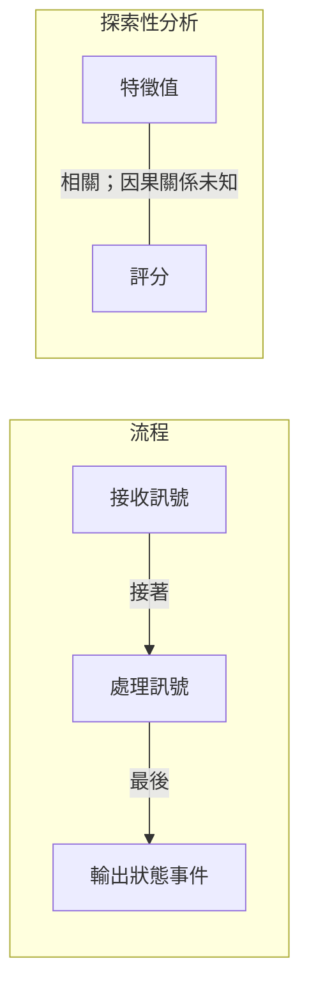

# 通用版行為試跑

日期：2026-11-04。以下為更新後實際作答，案例均為自製測試資料。

以人工指定路徑載入skill，不是兩平台原生呼叫測試。模型識別與取樣設定未提供。

## T1

系統使用兩個感測器蒐集設備狀態資料，再將資料傳送至伺服器分析。管理者可參考分析結果，觀察設備狀態。目前系統僅支援單一場域，尚未進行跨場域驗證。

## T2

本研究對 12 件測試樣本進行探索性分析。特徵值與評分的 Spearman ρ = 0.62 [7]。分析尚未控制測試批次差異，也未進行跨設備測試。因此，此相關無法支持因果推論，也不能確認其他設備的預測效能。

## T3

警告：高溫表面可能造成燙傷。

1. 關閉加熱器。
2. 等待溫度低於 40 °C。
3. 確認指示燈已熄滅。
4. 只有溫度低於 40 °C 且已確認指示燈熄滅後，才可拆下外蓋。若指示燈未熄滅，不得拆下外蓋。

## T4

1. 持續按住解鎖鈕，同時將旋鈕轉至 OPEN。
2. 執行 `tool --dataset raw_data --network local`。
3. 只有 A ≥ 5 且 B = 0 時，才可按 START。其他情況不得啟動。

## T5

資料在傳輸期間損毀。設定檔已通過靜態檢查，但此設定尚未在設備上執行。完成校正後，即可測量。

## T6

系統依序接收訊號、處理訊號，再輸出狀態事件。探索性分析顯示特徵值與評分相關，但因果關係未知。下圖以無方向連線表示相關，不表示因果。



## T7

```html
<!doctype html>
<html lang="zh-Hant">
<meta charset="utf-8">
<title>門檻與警報數：假設情境</title>
<style>
  body { font-family: sans-serif; color: #222; background: #fff; }
  button:focus-visible { outline: 3px solid #005fcc; outline-offset: 3px; }
</style>
<h1>門檻較低可能增加警報數</h1>
<p>假設輸入相同、其他條件不變，且超過門檻就產生警報。降低門檻可能讓更多輸入觸發警報；若沒有輸入落在兩個門檻之間，警報數也可能不變。</p>
<p>以下為假設情境，沒有實驗資料，無法確認實際警報數或增加幅度。</p>
<button type="button" id="toggle" aria-controls="scenario">切換至較低門檻情境</button>
<p id="scenario" aria-live="polite">情境一：採用較高門檻，作為比較基準。</p>
<script>
  let lower = false;
  const button = document.getElementById('toggle');
  const scenario = document.getElementById('scenario');
  button.addEventListener('click', () => {
    lower = !lower;
    scenario.textContent = lower
      ? '情境二：門檻較低，警報數可能增加，也可能不變。這是假設，尚無實驗資料驗證。'
      : '情境一：採用較高門檻，作為比較基準。';
    button.textContent = lower ? '切換至較高門檻情境' : '切換至較低門檻情境';
  });
</script>
</html>
```

## T8

| 原句 | 問題 | 建議改寫 |
| --- | --- | --- |
| 設備已經完成靜態檢查，因此我們毫無疑問地證明了系統可以在所有場域正常運作。 | 「完成靜態檢查」未說明檢查是否通過，也不能據此證明實際運作正常。「所有場域」超出所提供的驗證範圍；「毫無疑問」也缺乏證據支持。 | 設備已完成靜態檢查。僅憑此檢查，無法確認系統是否能在所有場域正常運作。 |

改寫已收斂原文超出證據的結論；依據是原文僅提供「已完成靜態檢查」。實際運作情況與場域驗證範圍仍待確認。

此檢查不足以宣稱正式通過 ASD-STE100 中文認證。本 skill 是依 ASD-STE100 原則設計的繁體中文改編，並非官方中文標準或認證工具；正式英文 STE 符合性須另依正式標準核對。

## T9

甲：校正完成後，即可測量。校正完成是可測量的條件之一，不代表唯一條件。

乙：只有校正完成，才可以測量。其他檢查也可能是必要條件，因此校正完成並不保證可以測量。

## G1

系統先讀取一個影格，再儲存該影格。

## G2

還需要設定內容、用途、適用的作業系統、硬體與工具資訊，以及預期行為和實際測試結果，才能判斷此設定是否能正常運作。

完整輸入與版本雜湊見 [generic-results.json](generic-results.json)。未將舊案例的文字替換當作本輪作答。
